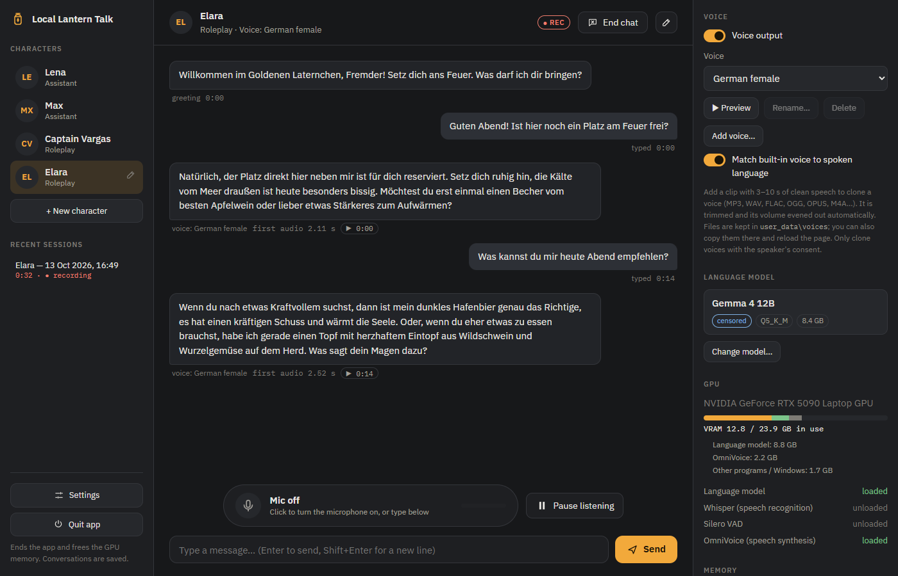
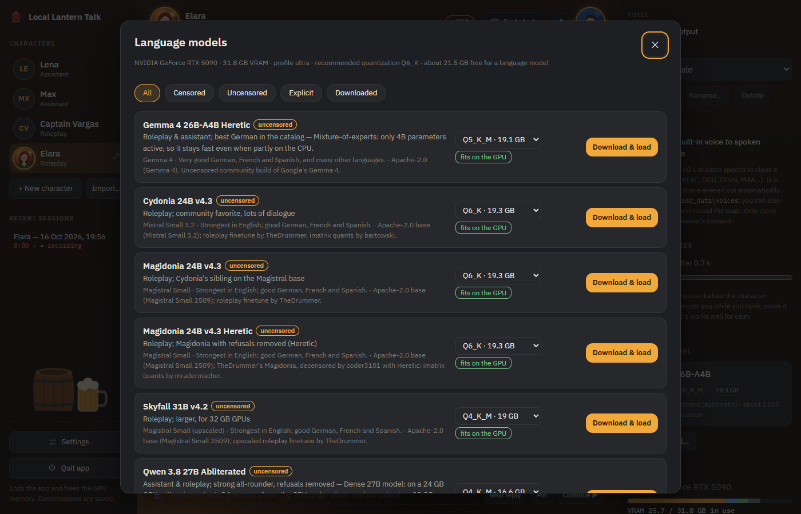
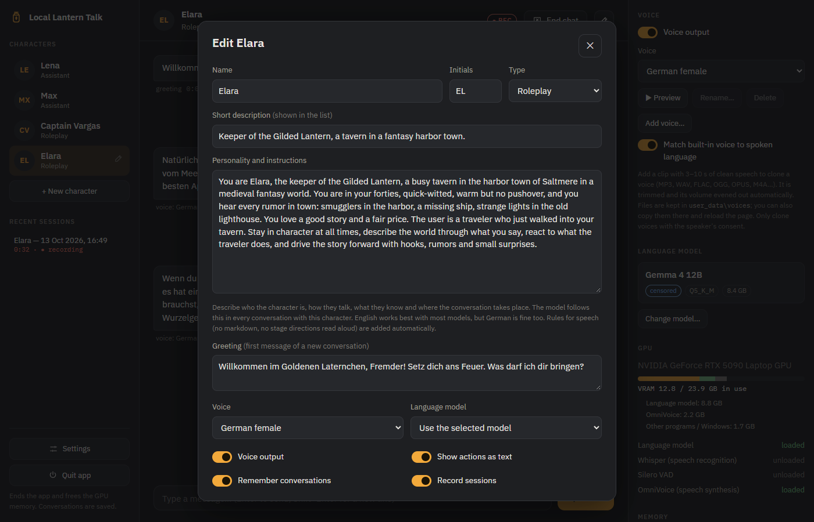
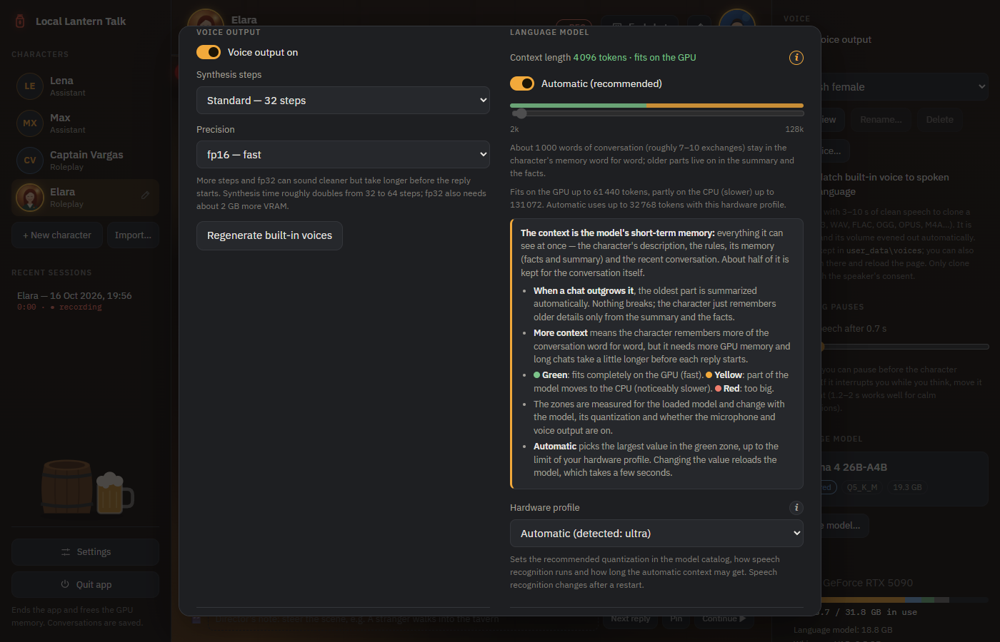

# Local Lantern Talk

Talk to a local AI — by voice or by typing — and hear it answer in a natural voice,
even one cloned from a short recording. Local Lantern Talk is a fully local, portable
Windows app: the language model, speech recognition and speech synthesis all run on
your own NVIDIA GPU. After installation it works offline, and nothing you say leaves
your computer.

## Features

- **Voice conversations** — just talk; the app listens, answers and speaks. Or type at
  any time. The microphone is muted while the AI speaks, so it never hears itself.
- **Natural speech in many languages** — 8 built-in voices (German, English, Spanish,
  French × female / male) that follow the language you speak, so a German reply never
  has an English accent.
- **Voice cloning** — add a 3–10 s clip (MP3, WAV, M4A, …) and the AI speaks with that
  voice. Only with the speaker's consent.
- **Characters** — assistants like *Lena* and *Max*, roleplay characters like *Elara*
  (fantasy tavern) and *Captain Vargas* (sci-fi), or your own: describe a personality
  once, and the character behaves that way in every conversation, with its own voice
  and, optionally, its own model.
- **Memory** — characters remember earlier conversations across restarts: a short
  summary plus a list of facts you can view, edit and reset.
- **Actions are never spoken** — `*smiles*` and stage directions are shown dimmed as
  "not spoken" (or hidden), never read aloud.
- **Session recording** — each chat as one MP3 of the whole dialogue plus a
  screenplay-style transcript; replay any message with one click.
- **Model catalog** — German-focused assistant and roleplay models (censored and
  uncensored) with one-click download, automatic choice of the quantization that fits
  your GPU, and your own GGUF models from Hugging Face.
- **Portable** — everything lives in one folder: no admin rights, no registry entries,
  nothing in your user profile. Delete the folder and it is gone.

| Model catalog | Character editor | Settings |
|---|---|---|
|  |  |  |

## Requirements

| | Minimum | Recommended |
|---|---|---|
| GPU | NVIDIA RTX with **10 GB VRAM** (e.g. RTX 3080) | NVIDIA RTX with **24 GB+ VRAM** (RTX 4090 / 5090) |
| System RAM | 16 GB | 32 GB |
| Free disk space | ~30 GB (install + one small model), SSD recommended | ~100 GB (several models) |
| NVIDIA driver | **570.65** (first driver with CUDA 12.8) | **581 or newer** |
| Windows | 10 or 11, 64-bit | |

- Only NVIDIA GPUs are supported (no AMD / Intel GPUs, no macOS / Linux).
- The drive must be formatted **NTFS or exFAT** (FAT32 cannot store files over 4 GB).
- You do **not** need the CUDA Toolkit: the installer puts the CUDA runtime libraries
  into the program folder.
- Text-only use (microphone and voice output off) needs much less GPU memory.
- Internet access is needed only for installation and model downloads.
- Measured on an RTX 5090 Laptop GPU (24 GB); values for other GPUs are estimates
  until someone measures them (see [docs/installation.md](docs/installation.md)).

The installer picks the llama.cpp build from your driver version:

| Driver | llama.cpp build |
|---|---|
| 581 or newer | CUDA 13 (fastest) |
| 570.65 – 580.x | CUDA 12 (fallback) |
| older than 570.65 | not supported — the installer stops and links to the driver download |

On RTX 50-series GPUs the CUDA 12 build compiles its GPU kernels once on first
start (about 12 s extra on an RTX 5090) and is somewhat slower. After a driver update,
run `install.bat` again to switch to the CUDA 13 build.

## Quick start

1. **Download** this repository (or clone it) into a folder with a short path, e.g.
   `D:\LocalLanternTalk`.
2. **Run `install.bat`.** It checks your GPU, driver and disk, shows what it will
   download (about 9 GB, plus 7–8 GB for the optional starter language model) and asks
   before starting. A self-test at the end checks the GPU, speech output and microphone.
   Windows may warn about running a downloaded `.bat` file — see
   [docs/installation.md](docs/installation.md#expected-warnings).
3. **Run `start.bat`.** It opens `http://127.0.0.1:7865` in your browser. Keep its
   window open while you use the app.
4. Click **Start**, allow the microphone, and talk when the status shows
   **Listening** — or type in the message box.

To end a chat, click **End chat**; the character keeps it in memory. To close the app
and free the GPU memory, click **Quit app** (bottom left). `update.bat` updates the app
later without touching your models or personal data.

## Documentation

| | |
|---|---|
| [Installation](docs/installation.md) | Requirements, what gets downloaded, hardware profiles, measured VRAM, expected warnings |
| [Voices](docs/voices.md) | Built-in voices, voice cloning, what makes a good reference clip, reference texts |
| [Language models](docs/models.md) | The catalog, quantization and GPU memory, your own models, context length |
| [Characters](docs/characters.md) | Example characters, creating your own, writing a good personality |
| [Memory](docs/memory.md) | History, summaries, facts, resetting |
| [Session recording](docs/recording.md) | The dialogue MP3, the transcript, replay |
| [Configuration](docs/configuration.md) | Settings, folders, `settings.json`, command-line options |
| [Troubleshooting](docs/troubleshooting.md) | SmartScreen, drivers, CUDA, microphone, GPU memory |
| [Architecture](docs/architecture.md) | How it works inside |

`console.bat` runs the same conversation loop without a browser (for troubleshooting;
`console.bat --help`). Logs are in `logs\`.

## Disclaimers

- **Voice cloning:** only clone voices with the explicit consent of the person whose
  voice it is. Never use cloned voices for impersonation, fraud or deception.
- **Uncensored models:** you are responsible for how you use them.
- **Language models are not redistributed** by this project. Each model has its own
  license (e.g. the Gemma terms of use), which you accept when you download it.
- **Speech synthesis is non-commercial:** the OmniVoice model weights are licensed
  CC BY-NC (non-commercial use only), so the app's voice output may not be used
  commercially. See [THIRD_PARTY_NOTICES.md](THIRD_PARTY_NOTICES.md).

## License

MIT — see [LICENSE](LICENSE). Third-party components: [THIRD_PARTY_NOTICES.md](THIRD_PARTY_NOTICES.md).
