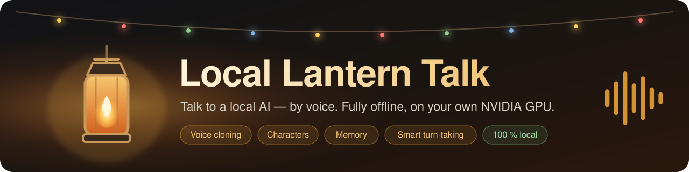

  

# Local Lantern Talk

Talk to a local AI — by voice or by typing — and hear it answer in a natural voice,
even one cloned from a short recording. Local Lantern Talk is a fully local, portable
Windows app: the language model, speech recognition and speech synthesis all run on
your own NVIDIA GPU. After installation it works offline, and nothing you say leaves
your computer.

### The web UI in action

*A roleplay chat with Elara: talk modes under the chat, a pinned and a one-time director's note, avatars
for her and for you, and a washed-out background picture. The pictures are drawn for the demo.*

## Features

- **Voice conversations** — just talk; the app listens, answers and speaks. Or type at
  any time. The microphone is muted while the AI speaks, so it never hears itself.
- **Talk your way** — three talk modes, one click under the chat: *Auto* (a short pause
  ends your turn), *Smart* (a small turn-detection model hears whether you sound
  finished, so the AI waits while you think) and *Push to talk*. *Hold on* collects
  everything you say until you click *Send*; *Stop* ends a reply at once.
- **Natural speech in many languages** — 8 built-in voices (German, English, Spanish,
  French × female / male), shipped with the app, that follow the language you speak, so
  a German reply never has an English accent.
- **Voice cloning** — add a 10–13 s clip (MP3, WAV, M4A, …), tell the app its language,
  and the AI speaks with that voice. Only with the speaker's consent.
- **Characters** — assistants like *Lena* and *Max*, roleplay characters like *Elara*
  (fantasy tavern) and *Captain Vargas* (sci-fi), or your own: describe a personality
  once, and the character behaves that way in every conversation, with its own voice,
  avatar, chat background, text colour, scene (tavern, space, red lantern, study) and,
  optionally, its own model. Export a character as a file and import it elsewhere.
- **Group chats and story mode** — up to four characters in one chat, each with its own
  voice, personality and way of speaking, all on the one loaded model. Lead the talk
  yourself, or press *Play* and let them tell a story with each other while you direct,
  pause or join in. Records as a ready-made audio drama.
- **Director's notes** — steer the story without saying it: "A stranger walks in",
  "It is a stormy night". For the next reply, pinned for good, or *Continue* to let the
  character go on by itself; in a group for everyone or one character. Never spoken.
- **Edit the conversation** — delete messages from the end (also from memory and the
  recording), let the AI write its last answer again, or edit any message: a changed
  reply is spoken again for the recording.
- **Easy characters** — new characters start from a template, or let the model write the
  instructions from a profile in your own words.
- **Your profile** — your name, a few words about you and your own avatar; every
  character knows who it talks to.
- **Memory** — characters remember earlier conversations across restarts: a short
  summary plus a list of facts you can view, edit and reset.
- **Actions are never spoken** — `*smiles*` and stage directions are shown dimmed as
  "not spoken" (or hidden), never read aloud.
- **Session recording** — each message as its own MP3 while the chat is open (so it can be
  deleted or edited), one MP3 of the whole dialogue when the chat ends, plus a
  screenplay-style transcript; replay any message with one click.
- **Model catalog** — German-focused assistant and roleplay models (censored,
  uncensored and explicit) with one-click download, automatic choice of the quantization
  that fits your GPU, and your own GGUF models from Hugging Face. A family mode hides the
  uncensored and explicit ones.
- **Fits your GPU** — the context length is chosen automatically from what really fits
  (measured per model); a slider with green / yellow / red zones lets you choose
  yourself. Hardware profiles from 10 GB up to 32 GB+.
- **Portable** — everything lives in one folder: no admin rights, no registry entries,
  nothing in your user profile. Delete the folder and it is gone.

| Conversation | Model catalog | Character editor | Settings |
|---|---|---|---|
|  |  |  |  |

## What you can do with it

What a conversation feels like depends on two things you choose: the **character**
(who you talk to) and the **language model** (how it thinks and what it is willing to
say). The same app covers a wide range:

| You want … | Character | Good models from the catalog |
|---|---|---|---|
| Casual, funny small talk | **Max**, or your own cheerful character | Mistral Small 3.2, Mistral Nemo 12B |
| A voice assistant for questions, explanations, brainstorming, writing | **Lena**, or your own expert character | Gemma 4 26B-A4B (best German), Gemma 4 12B |
| In-depth, well-founded discussions | **Professor Edmund Hale**, or your own specialist | Qwen 3.8 27B, Qwen3 14B, Gemma 4 26B-A4B |
| Interactive stories and roleplay | **Elara** (fantasy tavern), **Captain Vargas** (sci-fi), or your own | Cydonia, Magidonia, Skyfall, Gemma 4 26B-A4B Heretic, Mag-Mell 12B |
| Mature, uncensored roleplay (NSFW) between adults | **Vivienne** (*for adults only*), or your own adult character | Explicit models: Qwen 3.6 Uncensored Aggressive, Qwen 3.6 Abliterated, Mistral Small Abliterated, Dolphin 3.0; uncensored: Gemma 4 Heretic, Cydonia, Magidonia (Heretic), Qwen 3.8 Abliterated, Rocinante |

- **Censored** models (marked *censored* in the catalog) are the original releases by
  Google and Mistral: careful, precise, and they decline some topics. They are the best
  choice for factual work and family use.
- **Uncensored** models are community builds ("heretic", "abliterated") or roleplay
  finetunes that answer without the usual refusals — including explicit content. They
  can be slightly less precise than the originals.
- **Explicit** models are uncensored builds picked for adult content. **Family mode**
  (Settings) hides uncensored and explicit models and characters marked *For adults
  only*.
- The character's description steers tone and content just as much as the model: an
  uncensored model with a friendly assistant persona still behaves like an assistant.
- Every model runs **only on your computer**; nothing you say is sent anywhere.

> **Adult content:** uncensored models can produce explicit and disturbing content. Use
> them only if you are an adult, only for yourself, and within the law of your country.
> You are responsible for what you generate. Never use the app to create content
> involving minors, real people without their consent, or anything illegal.

## How it works

Everything runs locally on your NVIDIA GPU, in four steps per turn:

1. **Listen** — your browser sends the microphone audio to the app. **Silero VAD**
   detects when you start and stop speaking — in *Smart* mode **Smart Turn v3** also
   checks whether you sound finished — and **Whisper large-v3-turbo** (faster-whisper)
   turns your words into text and recognizes the language. You can also just type.
2. **Think** — **llama.cpp** runs the language model you picked in the **model catalog**
   (*Language model → Change model…*). Models are GGUF files from Hugging Face; the app
   downloads exactly one file, picks the quantization that fits your GPU memory, and
   splits the model between GPU and CPU if it does not fit completely. You can also add
   any other GGUF model by its Hugging Face name. The character's instructions, your
   profile, its memory (facts and a summary of earlier chats), your director's notes and
   rules for speakable answers are sent along with your message. See
   [docs/models.md](docs/models.md).
3. **Speak** — **OmniVoice** (k2-fsa) turns the reply into speech, sentence by sentence,
   so the voice starts while the model is still writing. It speaks with one of the
   8 built-in voices (designed with OmniVoice, shipped with the app) or clones a voice
   from a short clip you add — 10–13 s of clean speech plus its transcript, which Whisper
   writes for you. Built-in voices follow the language you speak. Stage directions like
   `*smiles*` are filtered out and never spoken. See [docs/voices.md](docs/voices.md).
4. **Remember and record** — each character keeps its own memory in a local database
   and can record every chat as an MP3 plus a transcript.
   See [docs/memory.md](docs/memory.md) and [docs/recording.md](docs/recording.md).

A turn usually takes 1.5–3 seconds from the end of your sentence to the first spoken
word on an RTX 5090. More technical details: [docs/architecture.md](docs/architecture.md).

## Requirements

| | Minimum | Recommended |
|---|---|---|---|
| GPU | NVIDIA RTX with **10 GB VRAM** (e.g. RTX 3080) | NVIDIA RTX with **24 GB+ VRAM** (RTX 4090 / 5090) |
| System RAM | 16 GB | 32 GB |
| Free disk space | ~30 GB (install + one small model), SSD recommended | ~100 GB (several models) |
| NVIDIA driver | **570.65** (first driver with CUDA 12.8) | **581 or newer** |
| Windows | 10 or 11, 64-bit | |

- Only NVIDIA GPUs are supported (no AMD / Intel GPUs, no macOS / Linux).
- The drive must be formatted **NTFS or exFAT** (FAT32 cannot store files over 4 GB).
- You do **not** need the CUDA Toolkit: the installer puts the CUDA runtime libraries
  into the program folder.
- Text-only use (microphone and voice output off) needs much less GPU memory.
- Internet access is needed only for installation and model downloads.
- Measured on an RTX 5090 Laptop GPU (24 GB) and a desktop RTX 5090 (32 GB); values for
  other GPUs are estimates until someone measures them (see
  [docs/installation.md](docs/installation.md)).

The installer picks the llama.cpp build from your driver version:

| Driver | llama.cpp build |
|---|---|
| 581 or newer | CUDA 13 (fastest) |
| 570.65 – 580.x | CUDA 12 (fallback) |
| older than 570.65 | not supported — the installer stops and links to the driver download |

On RTX 50-series GPUs the CUDA 12 build compiles its GPU kernels once on first
start (about 12 s extra on an RTX 5090) and is somewhat slower. After a driver update,
run `install.bat` again to switch to the CUDA 13 build.

## Quick start

1. **Create a new, empty folder** with a short path, e.g. `D:\LocalLanternTalk` (not
   on the OneDrive-synced Desktop).
2. **Get the app:** on GitHub click **Code → Download ZIP** and copy the contents of the
   `local-lantern-talk-main` folder from the ZIP into your folder — or run
   `git clone https://github.com/Slartibart23/local-lantern-talk D:\LocalLanternTalk`
   (easiest to update later). Details: [docs/installation.md](docs/installation.md#get-the-app).
3. **Install in a command window:** open the folder in Explorer, type `cmd` in the
   address bar and press Enter, then type `install.bat` and press Enter. It checks your
   GPU, driver and disk, shows what it will download (about 9 GB, plus 7–8 GB for the
   optional starter language model) and asks before starting. A self-test at the end
   checks the GPU, speech output and microphone. Windows may warn about running a
   downloaded `.bat` file — see [docs/installation.md](docs/installation.md#expected-warnings).
4. **Start:** type `start.bat`. It opens `http://127.0.0.1:7865` in your browser; keep
   its window open while you use the app. Loading the models takes up to 2 minutes —
   the page shows when it is ready.
5. Click **Start**, allow the microphone, and talk when the status shows
   **Listening** — or type in the message box.

Something went wrong? Copy the messages into Claude (<https://claude.ai>) and ask what
to do, or see [docs/troubleshooting.md](docs/troubleshooting.md).

To end a chat, click **End chat**; the character keeps it in memory. To close the app
and free the GPU memory, click **Quit app** (bottom left). `update.bat` updates the app
later without touching your models or personal data.

## Documentation

| | |
|---|---|
| [Installation](docs/installation.md) | Requirements, what gets downloaded, hardware profiles, measured VRAM, expected warnings |
| [Voices](docs/voices.md) | Built-in voices, voice cloning, what makes a good reference clip, reference texts |
| [Language models](docs/models.md) | The catalog, quantization and GPU memory, your own models, context length |
| [Characters](docs/characters.md) | Example characters, creating your own, writing a good personality |
| [Group chats and story mode](docs/group-chat.md) | Up to four characters, story mode, director's notes per character |
| [Memory](docs/memory.md) | History, summaries, facts, resetting |
| [Session recording](docs/recording.md) | The dialogue MP3, the transcript, replay |
| [Configuration](docs/configuration.md) | Settings, folders, `settings.json`, command-line options |
| [Troubleshooting](docs/troubleshooting.md) | SmartScreen, drivers, CUDA, microphone, GPU memory |
| [Architecture](docs/architecture.md) | How it works inside |

`console.bat` runs the same conversation loop without a browser (for troubleshooting;
`console.bat --help`). Logs are in `logs\`.

## Disclaimers

- **Use at your own risk:** Local Lantern Talk is provided as is, without any warranty.
  You use it at your own risk and are responsible for what you do with it and what you
  generate with it.
- **Use it responsibly and respect privacy:** respect other people's privacy and
  rights. Record, clone, imitate or talk about real people only with their consent, and
  never use the app to harass, deceive or harm anyone.
- **Voice cloning:** only clone voices with the explicit consent of the person whose
  voice it is. Never use cloned voices for impersonation, fraud or deception.
- **Uncensored models:** you are responsible for how you use them.
- **Language models are not redistributed** by this project. Each model has its own
  license (e.g. the Gemma terms of use), which you accept when you download it.
- **Noncommercial use only:** the app's license allows noncommercial use only (see License).
- **Speech synthesis is non-commercial:** the OmniVoice model weights are licensed
  CC BY-NC (non-commercial use only), so the app's voice output may not be used
  commercially. See [THIRD_PARTY_NOTICES.md](THIRD_PARTY_NOTICES.md).

## License

[PolyForm Strict License 1.0.0](https://polyformproject.org/licenses/strict/1.0.0/) — see
[LICENSE](LICENSE). In short: free to use for any **noncommercial** purpose; changing the
software, sharing changed versions or commercial use only with the author's permission
(ask via [GitHub issues](https://github.com/Slartibart23/local-lantern-talk/issues)). Your
own characters, voices, settings and the configuration files are yours to change.
Third-party components: [THIRD_PARTY_NOTICES.md](THIRD_PARTY_NOTICES.md).
